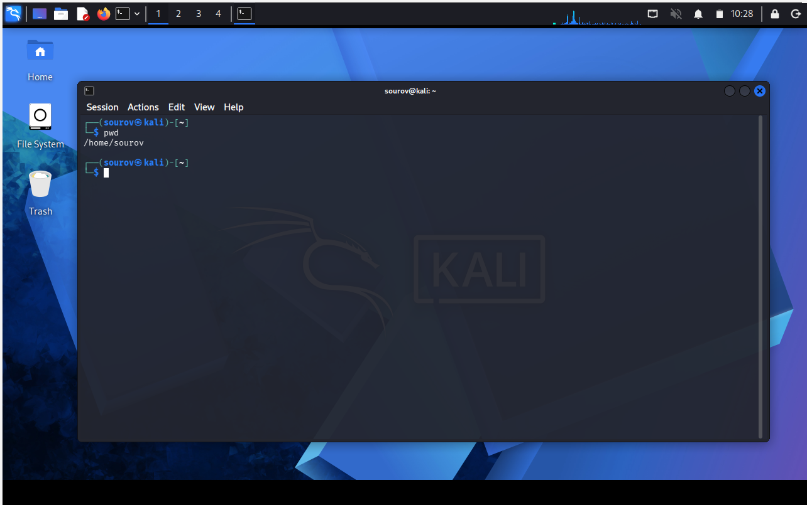
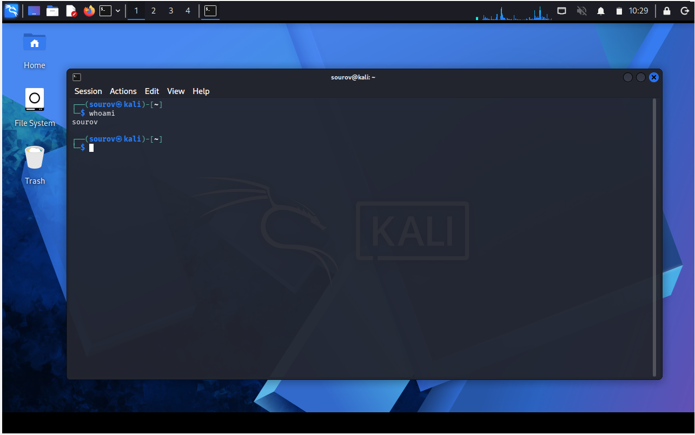
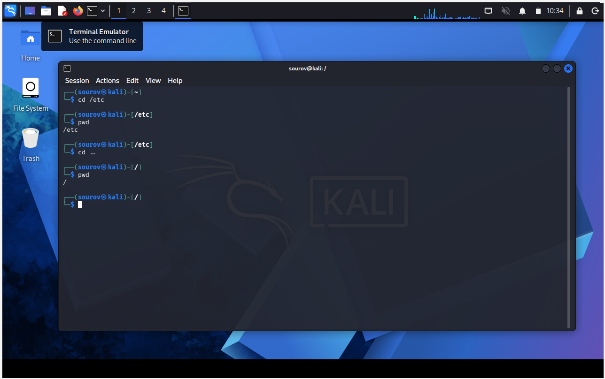
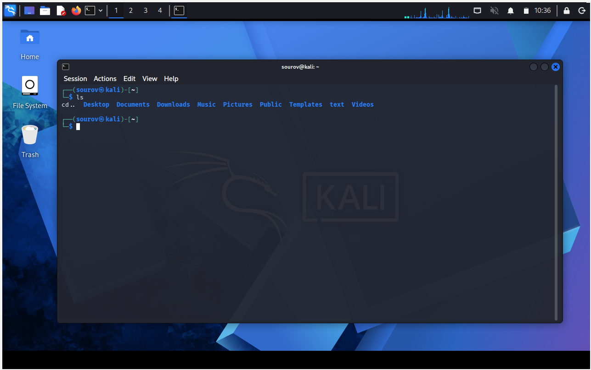
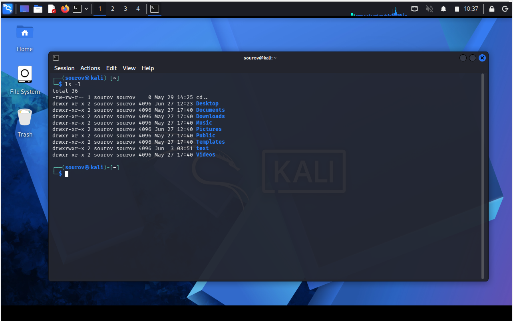
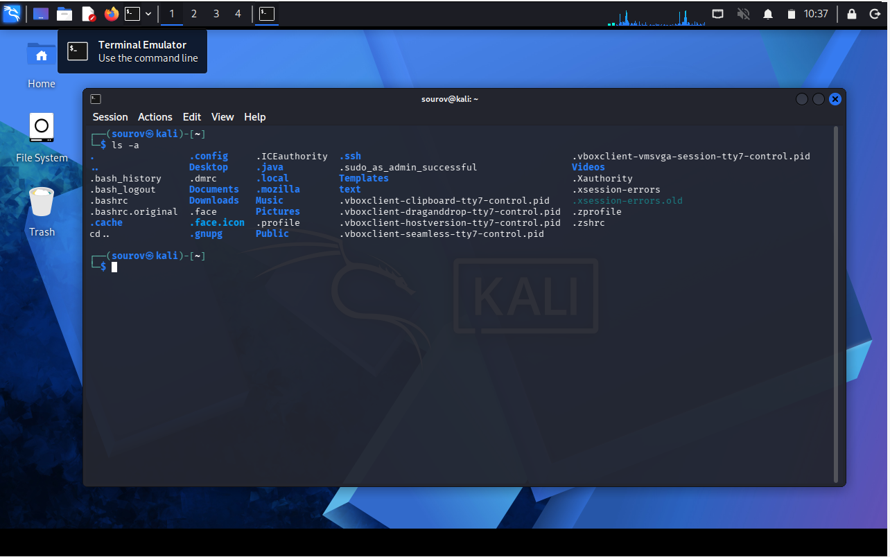
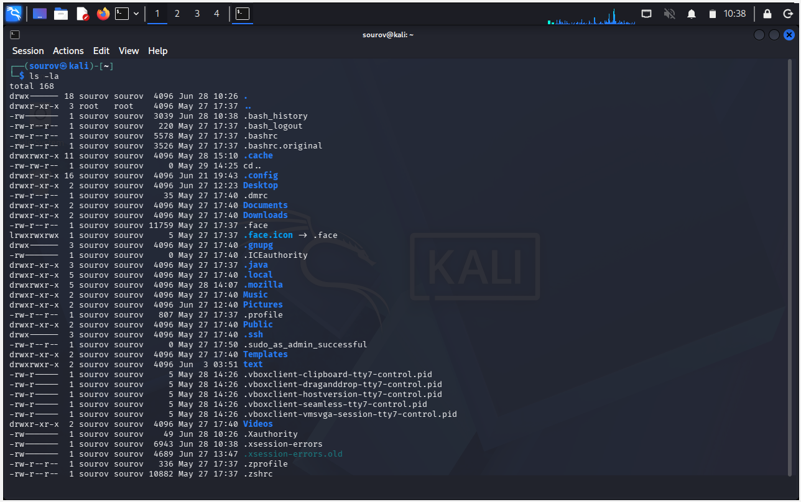
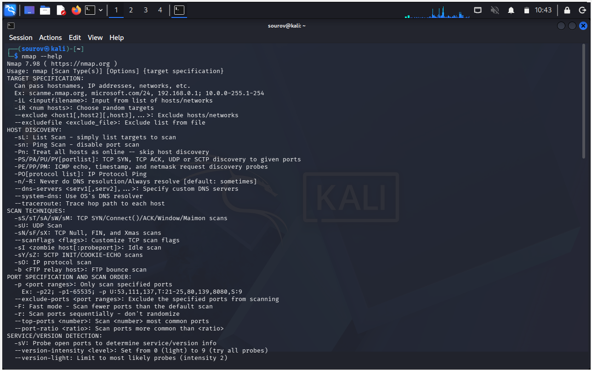

# Day 03: Linux Basics & Core Commands

This note covers foundational Linux commands for navigating the filesystem, identifying the current user, inspecting directory contents, and finding command documentation. The examples use a Kali Linux shell, but these commands are available on most Linux distributions.

> **Learning objective:** Be able to explain what each command does, choose an appropriate option, and verify the result in an authorized local environment.

---

## 1. Check the current directory with `pwd`

`pwd` prints the absolute path of the current working directory. Knowing where you are helps prevent running commands against the wrong files or folders.

```bash
sourov@kali:~$ pwd
/home/sourov
```



---

## 2. Identify the current user with `whoami`

`whoami` prints the username associated with the current effective user ID. It is useful to confirm which account a shell is using. It does **not** show every group or permission; use `id` for that information.

```bash
sourov@kali:~$ whoami
sourov

sourov@kali:~$ id
uid=1000(sourov) gid=1000(sourov) groups=1000(sourov)
```

Most everyday commands can run as a regular user. Some administrative actions or particular operations may require elevated privileges; requirements depend on the command and its options. Use elevated privileges only when needed and authorized.



---

## 3. Navigate directories with `cd`

`cd` is a shell built-in that changes the current working directory.

| Command | Meaning |
|---|---|
| `cd /etc` | Go to the absolute path `/etc`. |
| `cd ..` | Go to the parent of the current directory. |
| `cd ../..` | Go up two directory levels. |
| `cd ~` | Go to the current user's home directory. |
| `cd -` | Return to the previous working directory. |

An **absolute path** starts from `/`; a **relative path** is interpreted from the current directory.

```bash
sourov@kali:~$ cd /etc
sourov@kali:/etc$ pwd
/etc
sourov@kali:/etc$ cd ..
sourov@kali:/$ pwd
/
```



---

## 4. Inspect directory contents with `ls`

`ls` lists directory entries. With no path argument, it lists the current directory; with a path, it lists that directory.

| Option | Meaning |
|---|---|
| `-l` | Use a long format showing permissions, link count, owner, group, size, and modification time. |
| `-a` | Include hidden entries whose names begin with `.` (including `.` and `..`). |
| `-h` | With `-l`, display file sizes in a human-readable format. |

Combine options as `ls -lah` (or `ls -alh`). In a long listing, the displayed timestamp is generally the **last modification time**, not the file's creation time. File metadata and available timestamps can vary by filesystem.

```bash
sourov@kali:~$ ls
Desktop  Documents  Downloads  Music  Pictures  Public  Templates  Videos

sourov@kali:~$ ls -lah
```









---

## 5. Find command options with `--help`

Many command-line programs provide a brief usage summary with `--help`; some use `-h`, and behavior is program-specific. Check the command's own help output rather than assuming every program follows the same convention.

```bash
sourov@kali:~$ ls --help
sourov@kali:~$ nmap --help
```

The `nmap` example displays help text only. If practicing security tools, use them only on systems and networks you own or have explicit permission to assess.




---

## 6. Read manual pages with `man`

`man` opens the installed manual page for a command. Manual pages provide more detail than a short help summary; availability depends on the package and system configuration.

```bash
sourov@kali:~$ man ls
```

Useful navigation keys in the pager:

- `Space` or `Page Down`: move forward one page.
- `b` or `Page Up`: move backward one page.
- `/term` then `Enter`: search for `term`; press `n` for the next match.
- `q`: quit the manual page.


---

## Hands-on practice

Practice in your own home directory. These commands create a small, harmless example folder and file, then inspect them. The `mkdir` and `touch` commands are included here to make the navigation and listing exercise reproducible.

```bash
cd ~
mkdir -p linux-practice/day03
cd linux-practice/day03
pwd
touch notes.txt
ls -lah
cd ..
pwd
cd -
pwd
```

**Check your understanding:** What changes in the output between `ls`, `ls -l`, and `ls -la`? Which command confirms your current location, and which one confirms your username?

---

## Quick reference

| Command | Example | Purpose |
|---|---|---|
| `pwd` | `pwd` | Print the current working directory. |
| `whoami` | `whoami` | Print the effective username. |
| `id` | `id` | Show user and group IDs. |
| `cd` | `cd /etc` | Change the current working directory. |
| `ls` | `ls -lah` | List entries, including hidden entries, with detailed information. |
| `--help` | `ls --help` | Show a program's brief help, where supported. |
| `man` | `man ls` | Open the installed manual page. |

## Key takeaways

1. Use `pwd` to verify the current working directory before acting on files.
2. Use `whoami` to identify the current effective username; use `id` to inspect user and group IDs.
3. Understand whether a path is absolute or relative before using `cd`.
4. Use `ls -lah` to inspect hidden entries and common file metadata; its timestamp is not generally a creation time.
5. Consult the program's own `--help` output or manual page, since options vary between programs.
6. Use security tools only within an explicitly authorized scope.
