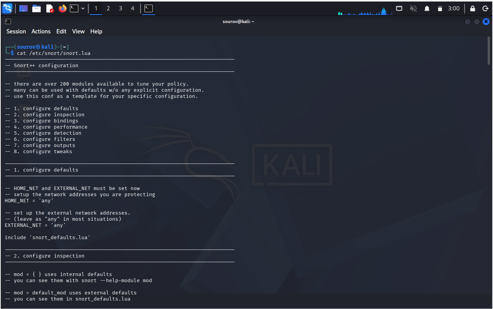
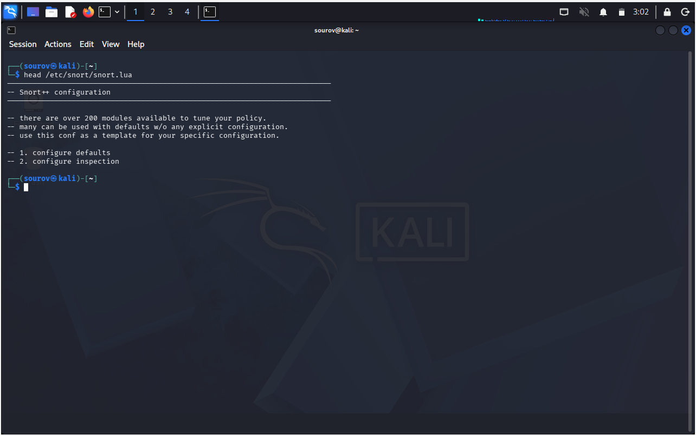
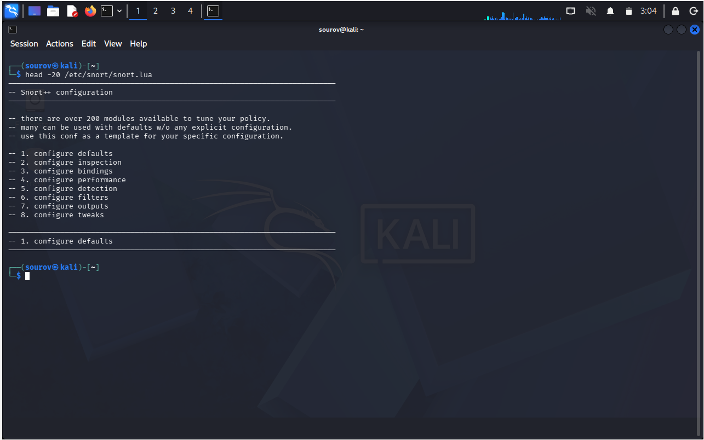
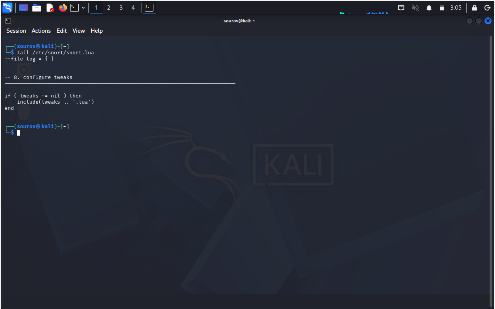
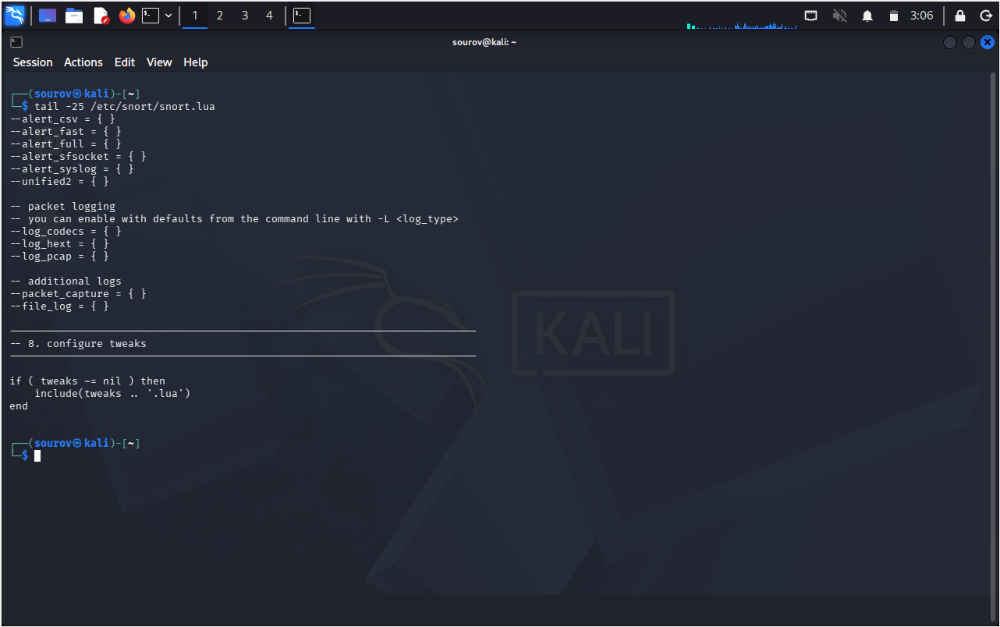
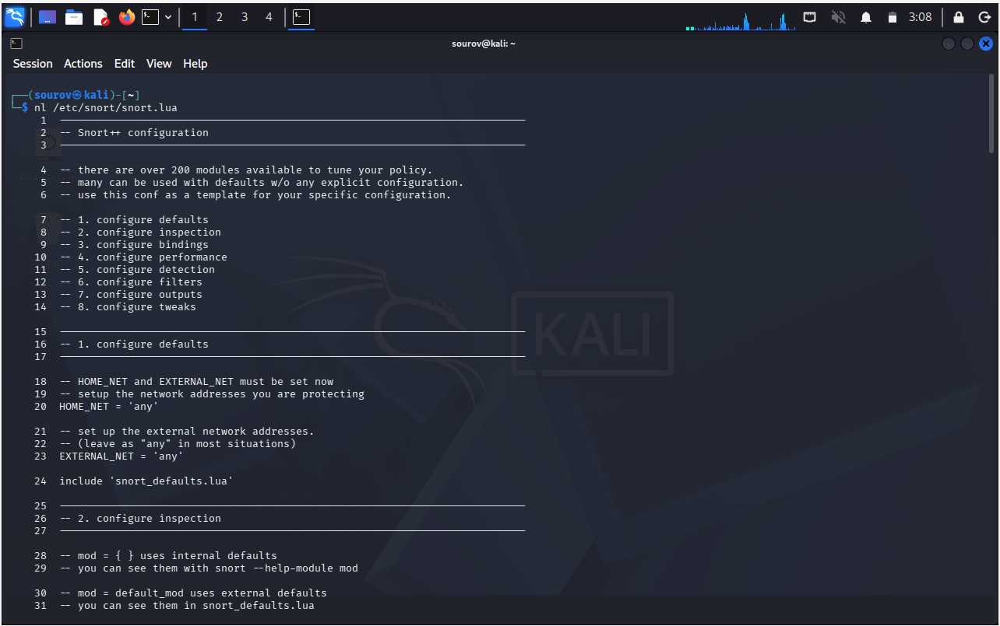
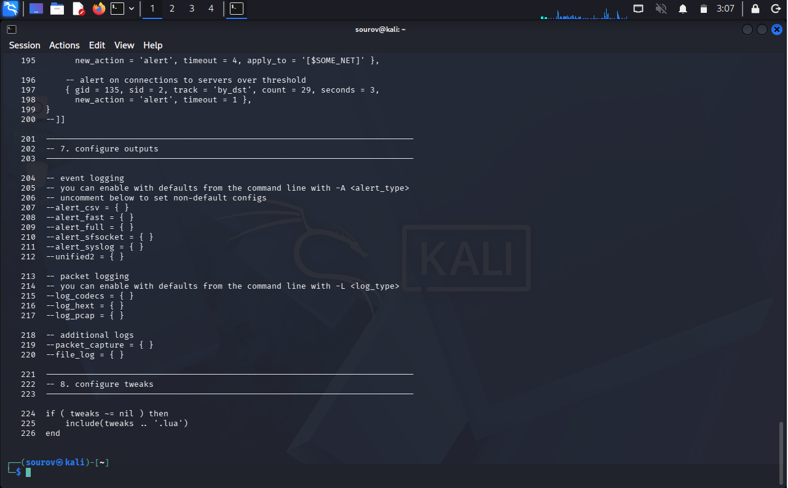

# Day 06: Linux Text Manipulation Utilities

This note covers basic Linux utilities for displaying and inspecting text files: `cat`, `head`, `tail`, and `nl`. The examples use a Snort configuration file to illustrate common administrative tasks; use system configuration files only on systems you own or are authorized to administer. You can practice the commands safely with a file in your home directory.

> **Learning objective:** Choose a suitable command to display all or part of a text file, inspect its beginning or end, and add line numbers for easier reference.

## Table of Contents
* [Why text utilities matter](#why-text-utilities-matter)
* [Display file contents with `cat`](#display-file-contents-with-cat)
* [View the beginning of a file with `head`](#view-the-beginning-of-a-file-with-head)
* [View the end of a file with `tail`](#view-the-end-of-a-file-with-tail)
* [Number lines with `nl`](#number-lines-with-nl)
* [Hands-on practice](#hands-on-practice)
* [Quick Reference](#quick-reference)
* [Related Topics](#related-topics)
* [Key Takeaways](#key-takeaways)

---

## Why text utilities matter

Linux configuration files and logs are often stored as text. Text utilities let administrators inspect those files from a terminal without opening a graphical editor. They are useful when checking configuration, troubleshooting a service, or locating relevant information in a long file.

A common administrative workflow is to inspect a file, make an intentional change with an appropriate editor, verify the result, and follow the application's documented process for reloading or restarting it. Do not edit system configuration unless you understand the change and have authorization.

### Security context: reviewing Snort configuration

Snort is a network intrusion detection and prevention system. Administrators may inspect its configuration and rule-related settings to verify that monitoring is configured as intended. The commands in this note are for reading and reviewing files; they do not replace Snort's documentation or a careful configuration-validation process.

If Snort is installed and the configuration file is present on your system, the examples below use `/etc/snort/snort.lua`. Paths can vary by distribution and installation. Check the actual path before running a command, and do not assume that Snort is installed.

---

## Display file contents with `cat`

`cat` reads one or more files and writes their contents to standard output. It is convenient for short files, but a large file can scroll past the terminal quickly. For a long file, use a pager or inspect only the section you need with `head` or `tail`.

```bash
cat /etc/snort/snort.lua
```



Use `cat` with a practice file as well:

```bash
cat ~/linux-practice/day06/sample.txt
```

---

## View the beginning of a file with `head`

`head` displays the beginning of a file. By default, it prints the first **10 lines**. Use `-n` to request a specific number of lines; the compact form such as `head -20` is also commonly supported.

```bash
head /etc/snort/snort.lua
head -n 20 /etc/snort/snort.lua
```





This is useful for checking introductory comments, version information, or the start of a configuration file without printing the entire file.

---

## View the end of a file with `tail`

`tail` displays the end of a file. By default, it prints the last **10 lines**. Specify a different count with `-n`; for example, `tail -n 25` displays the final 25 lines. The compact form `tail -25` is also commonly supported.

```bash
tail /etc/snort/snort.lua
tail -n 25 /etc/snort/snort.lua
```





The end of a configuration file may contain additional settings or include directives, but its contents depend on the file and version. `tail` is also useful for quickly inspecting the latest lines of a log. To follow a growing log as new lines are written, use `tail -f` only when appropriate and stop it with `Ctrl+C`.

---

## Number lines with `nl`

`nl` writes a file to standard output with line numbers. By default, it numbers non-empty lines; blank lines are not numbered. This can make it easier to refer to specific configuration lines when reviewing a file or discussing an issue.

```bash
nl /etc/snort/snort.lua
```





To number blank lines too, use `-ba`:

```bash
nl -ba ~/linux-practice/day06/sample.txt
```

---

## Hands-on practice

Create a small sample file in your home directory, then try each utility. These commands only create and read files under `~/linux-practice/day06`.

```bash
mkdir -p ~/linux-practice/day06
cat > ~/linux-practice/day06/sample.txt <<'EOF'
Linux text utilities
cat displays file contents.
head reads from the beginning.

 tail reads from the end.
nl adds line numbers.
EOF

cat ~/linux-practice/day06/sample.txt
head -n 2 ~/linux-practice/day06/sample.txt
tail -n 2 ~/linux-practice/day06/sample.txt
nl ~/linux-practice/day06/sample.txt
nl -ba ~/linux-practice/day06/sample.txt
```

**Check your understanding:** Which command shows the first lines of a file? Which one shows its last lines? What is different about the output of `nl` and `nl -ba` when the file contains a blank line?

---

## Quick Reference

| Command | Example | Purpose |
|---|---|---|
| `cat` | `cat sample.txt` | Display the complete contents of a file; most convenient for short files. |
| `head` | `head sample.txt` | Display the first 10 lines by default. |
| `head -n N` | `head -n 20 sample.txt` | Display the first `N` lines. |
| `tail` | `tail sample.txt` | Display the last 10 lines by default. |
| `tail -n N` | `tail -n 25 sample.txt` | Display the last `N` lines. |
| `tail -f` | `tail -f app.log` | Continue displaying new lines appended to a file; stop with `Ctrl+C`. |
| `nl` | `nl sample.txt` | Display lines with numbers; blank lines are not numbered by default. |
| `nl -ba` | `nl -ba sample.txt` | Number all lines, including blank lines. |

---

## Related Topics
* [Day-03](../Day-03/that_day_learning.md)
* [Day-04](../Day-04/that_day_learning.md)
* [Day-05](../Day-05/that_day_learning.md)

---

## Key Takeaways

1. Use `cat` for short files; large files are often easier to inspect with a pager or partial-view commands.
2. Use `head` to inspect the beginning of a file and `tail` to inspect its end.
3. Both `head` and `tail` show 10 lines by default; `-n N` selects a custom line count.
4. Use `nl` to add line numbers when referencing text; by default, blank lines are not numbered.
5. Practice with files in your home directory and inspect system configuration only when authorized.

---

*Last Modified: November 10, 2026*
