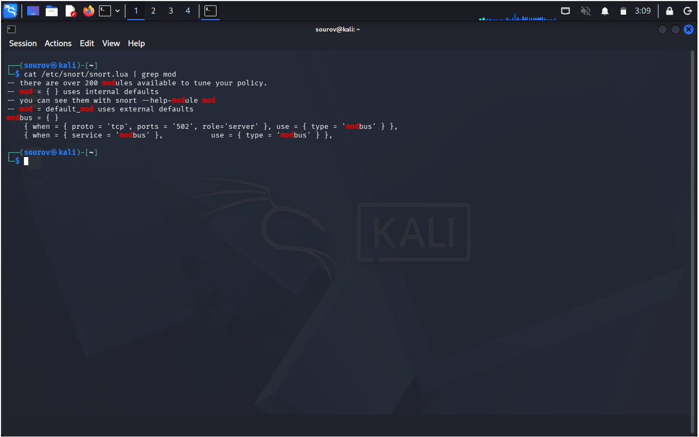
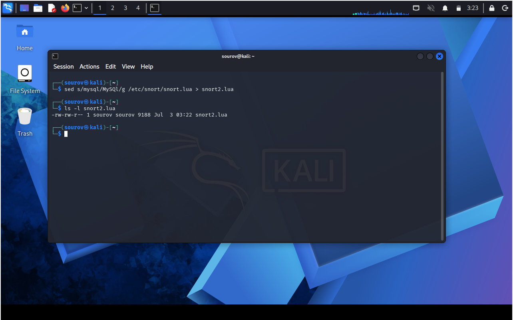
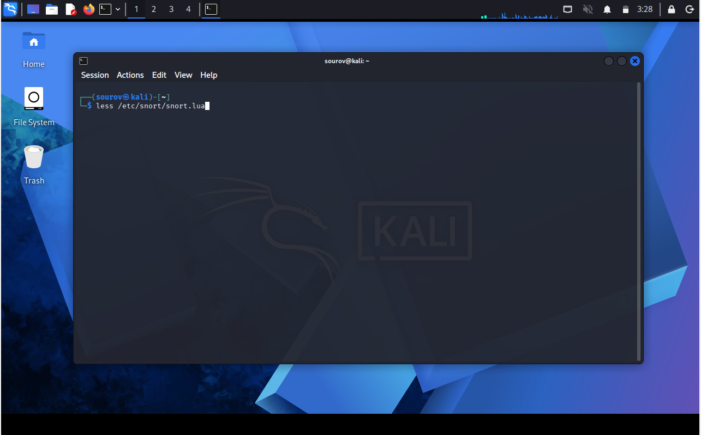
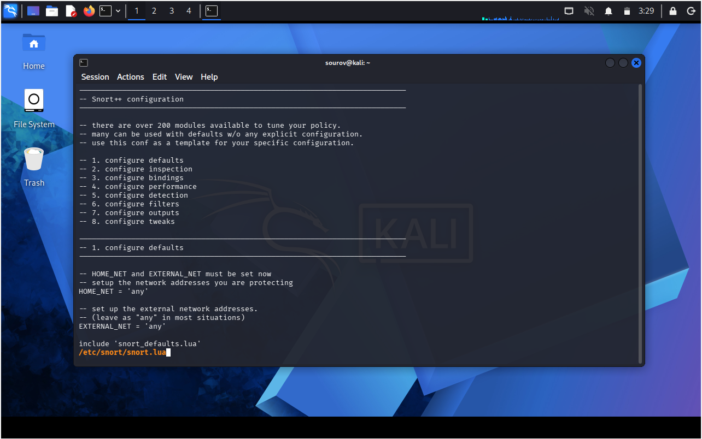

# Day 07: Linux Text Manipulation Utilities (Part 2)

This note covers additional Linux text utilities for searching, editing, and reading text files: `grep`, `sed`, `more`, and `less`. It also shows how to combine commands with pipes to locate and inspect a small section of a file. The examples use Snort configuration paths for context, but paths and line numbers can vary between systems. Practice with files in your home directory, and inspect or edit system files only on systems you own or are authorized to administer.

> **Learning objective:** Be able to search text with `grep`, understand basic `sed` substitutions, page through large files with `more` and `less`, and safely extract a chosen range of lines.

## Table of Contents
* [Search text with `grep`](#search-text-with-grep)
* [Inspect a line range with command pipelines](#inspect-a-line-range-with-command-pipelines)
* [Substitute text with `sed`](#substitute-text-with-sed)
* [Read large files with `more` and `less`](#read-large-files-with-more-and-less)
* [Hands-on practice](#hands-on-practice)
* [Quick Reference](#quick-reference)
* [Related Topics](#related-topics)
* [Additional Resources](#additional-resources)
* [Key Takeaways](#key-takeaways)

---

## Search text with `grep`

`grep` searches input for lines matching a pattern and prints matching lines. It is useful for finding settings, keywords, or messages in a configuration file or log. Linux searches are case-sensitive by default, so `mod` and `Mod` are different patterns.

```bash
grep 'mod' /etc/snort/snort.lua
```

Use `-n` to include matching line numbers and `-i` to ignore case:

```bash
grep -n 'mod' /etc/snort/snort.lua
grep -in 'mod' /etc/snort/snort.lua
```



You can search a file directly with `grep`; piping `cat` into `grep` is usually unnecessary. A pipe is useful when the text comes from another command:

```bash
some_command | grep 'pattern'
```

---

## Inspect a line range with command pipelines

Sometimes you know a line number and want to inspect a small surrounding section instead of printing an entire file. First find the matching line with `grep -n`. Then use `tail -n +N` to start at line `N` and `head -n COUNT` to limit the output.

```bash
grep -n -- '-file_log' /etc/snort/snort.lua
```

After checking the reported line number, set the desired start line and count. For example, to print 8 lines beginning at line 213:

```bash
tail -n +213 /etc/snort/snort.lua | head -n 8
```

Here, `tail -n +213` starts at line 213, and `head -n 8` keeps only the first 8 lines from that output. Replace `213` with the correct start line for your file; line numbers can differ across versions. This pipeline only displays text and does not modify the source file.

---

## Substitute text with `sed`

`sed` (stream editor) reads text, applies requested editing commands, and writes the result to standard output. A basic substitution uses the form `s/old/new/`. By default, it replaces the first match on each input line; adding `g` replaces every match on each line. Matching is case-sensitive unless the expression or options specify otherwise.

The following examples read a Snort configuration and save the transformed output to a separate file rather than editing the original:

```bash
sed 's/mysql/MySQL/' /etc/snort/snort.lua > ~/linux-practice/day07/snort-first-match.lua
sed 's/mysql/MySQL/g' /etc/snort/snort.lua > ~/linux-practice/day07/snort-all-matches.lua
```

In the first command, only the first `mysql` match on each line is replaced. In the second, every `mysql` match on each line is replaced. The source file remains unchanged; the output file is created or overwritten, so choose its path carefully.

To inspect matching lines before or after a transformation, use `grep` on the source or output file:

```bash
grep -in 'mysql' /etc/snort/snort.lua
grep -in 'MySQL' ~/linux-practice/day07/snort-all-matches.lua
```

Do not test substitutions directly on live configuration files. Use a copy, review the output, and follow the application's documentation and change-control process before applying any configuration change.



---

## Read large files with `more` and `less`

`more` and `less` display text a screenful at a time, making large files easier to read than streaming the entire file with `cat`.

### Use `more` for page-by-page viewing

```bash
more /etc/snort/snort.lua
```

- Press `Space` to move forward a page.
- Press `Enter` to move forward one line.
- Press `q` to quit.


### Use `less` for flexible navigation and search

```bash
less /etc/snort/snort.lua
```

`less` supports moving both forward and backward through the file. While viewing it:

- Press `Space` or `Page Down` to move forward; press `b` or `Page Up` to move backward.
- Type `/term` and press `Enter` to search forward for `term`.
- Press `n` to go to the next match and `N` to go to the previous match.
- Press `q` to quit.





---

## Hands-on practice

Practice with a file in your home directory. These commands create a sample file, search it, display a selected range, write substitution results to a separate file, and open it in a pager.

```bash
mkdir -p ~/linux-practice/day07
cat > ~/linux-practice/day07/sample.txt <<'EOF'
Snort configuration notes
mod output is enabled in this example.
mysql rule paths may appear in configuration text.
A second mysql example is included on this line: mysql.
Use grep to find matching lines.
EOF

grep -n 'mysql' ~/linux-practice/day07/sample.txt
tail -n +2 ~/linux-practice/day07/sample.txt | head -n 3
sed 's/mysql/MySQL/g' ~/linux-practice/day07/sample.txt > ~/linux-practice/day07/sample-edited.txt
grep -n 'MySQL' ~/linux-practice/day07/sample-edited.txt
less ~/linux-practice/day07/sample.txt
```

**Check your understanding:** How does `grep -n` help you locate a match? What is the difference between `sed 's/old/new/'` and `sed 's/old/new/g'`? Which keys let you search in `less` and exit the pager?

---

## Quick Reference

| Command | Example | Purpose |
|---|---|---|
| `grep` | `grep 'mod' file.txt` | Print lines matching a pattern. |
| `grep -n` | `grep -n 'mod' file.txt` | Include line numbers for matching lines. |
| `grep -i` | `grep -i 'mod' file.txt` | Search without distinguishing letter case. |
| `tail` + `head` | `tail -n +10 file.txt \| head -n 5` | Display 5 lines beginning at line 10. |
| `sed` | `sed 's/old/new/' file.txt` | Replace the first match on each line in output. |
| `sed` with `g` | `sed 's/old/new/g' file.txt` | Replace every match on each line in output. |
| `more` | `more file.txt` | View a file a page at a time. |
| `less` | `less file.txt` | Navigate and search a file interactively. |

---

## Related Topics
* [Day-03](../Day-03/that_day_learning.md)
* [Day-04](../Day-04/that_day_learning.md)
* [Day-05](../Day-05/that_day_learning.md)
* [Day-06](../Day-06/that_day_learning.md)

---

## Additional Resources
* Use `man grep`, `man sed`, `man more`, and `man less` to read the manual pages installed on your system.

---

## Key Takeaways

1. Use `grep` to find matching lines; add `-n` for line numbers and `-i` for case-insensitive matching.
2. Combine commands with a pipe (`|`) when one command's output should become another command's input.
3. Use `tail -n +N file | head -n COUNT` to display a limited range beginning at line `N`.
4. `sed` writes transformed text to standard output; redirect to a separate file when testing substitutions so the original remains unchanged.
5. Use `more` or `less` to navigate large files interactively; `less` also supports searching within the file.
6. Verify paths and work only with files and systems you are authorized to access or change.

---

*Last Modified : November 11, 2026*
