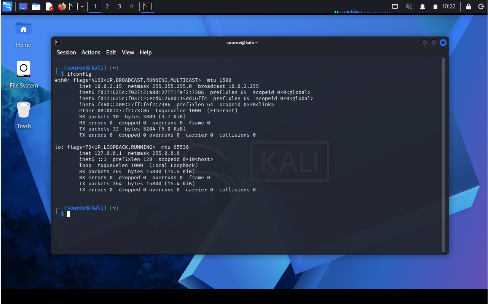
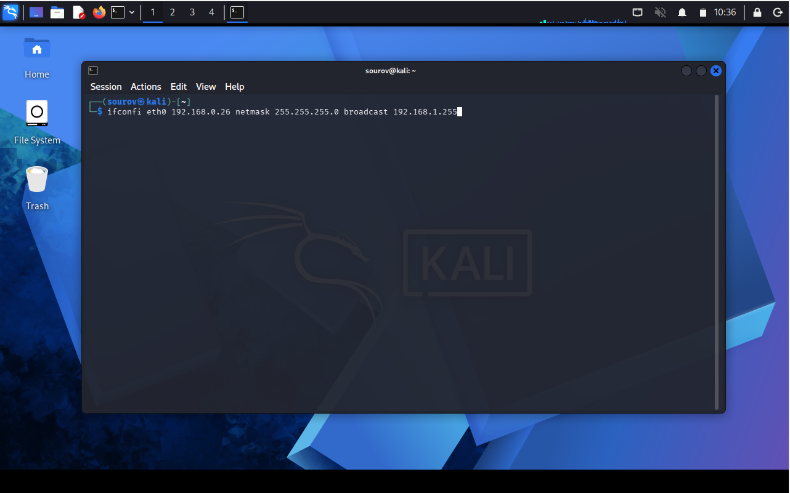

# Day 08: Linux Networking Basics

This note covers foundational Linux networking commands for inspecting network interfaces, viewing wireless-device information, and understanding IP address configuration. Examples use a Kali Linux shell; interface names and available commands vary by system.

> **Learning objective:** Identify local network interfaces and their addresses, inspect wireless status, and understand the effects of network configuration changes in an authorized lab or on a system you administer.

## Table of Contents
* [Inspect network interfaces with `ip` and `ifconfig`](#inspect-network-interfaces-with-ip-and-ifconfig)
* [Inspect wireless interfaces with `iw` and `iwconfig`](#inspect-wireless-interfaces-with-iw-and-iwconfig)
* [Understand IP address configuration](#understand-ip-address-configuration)
* [Understand subnet masks and broadcast addresses](#understand-subnet-masks-and-broadcast-addresses)
* [Understand MAC addresses and interface state](#understand-mac-addresses-and-interface-state)
* [Hands-on practice](#hands-on-practice)
* [Quick Reference](#quick-reference)
* [Related Topics](#related-topics)
* [Additional Resources](#additional-resources)
* [Key Takeaways](#key-takeaways)

---

## Inspect network interfaces with `ip` and `ifconfig`

`ip` is the modern iproute2 utility for inspecting and managing network interfaces, addresses, and routes. `ifconfig` is a traditional utility that may not be installed by default on modern distributions.

Interface names vary. Older examples may use `eth0` or `wlan0`; modern systems commonly use names such as `enp0s3` or `wlp2s0`. The loopback interface, usually `lo`, is software-based and lets programs communicate with the same host. Its IPv4 localhost address is `127.0.0.1`.

```bash
# Show network interfaces and addresses
ip addr show

# Show link-layer details and interface state
ip link show

# Legacy command, if installed
ifconfig
```

Use the actual interface name shown by your system rather than assuming it is `eth0`.



---

## Inspect wireless interfaces with `iw` and `iwconfig`

`iw` is the modern command-line utility for querying and configuring wireless devices. `iwconfig` is an older wireless-tools command and may not be installed. Wireless information is available only when the system has a supported wireless adapter and the necessary permissions and drivers.

```bash
# List wireless devices and their current settings
 iw dev

# Legacy wireless-tools output, if installed
 iwconfig
```

Wireless status may include the interface name, operating mode, frequency, connected network, and signal information. Use these commands only to inspect your own device or a network you are authorized to administer.


---

## Understand IP address configuration

An IP address identifies an interface on an IP network. `ip addr show` displays the addresses currently assigned to interfaces. Adding or removing an address changes local network configuration and may interrupt connectivity; use only an address and prefix assigned for your authorized lab or network.

The following syntax illustrates how an administrator can add or remove a lab address. Replace `eth0` with the interface name on your system and use values provided by your network or lab configuration.

```bash
# Inspect current addresses first
ip addr show dev eth0

# Example syntax only: configure an authorized lab address
sudo ip addr add 192.0.2.10/24 dev eth0

# Remove the same address when finished
sudo ip addr del 192.0.2.10/24 dev eth0
```

`192.0.2.0/24` is reserved for documentation examples and is not intended as a real network assignment. In normal use, prefer your distribution's network manager or the values supplied by the network administrator.


---

## Understand subnet masks and broadcast addresses

A prefix length describes how many leading bits of an IP address identify the network. For example, `/24` corresponds to the subnet mask `255.255.255.0`; `/16` corresponds to `255.255.0.0`. The broadcast address is determined by the subnet and is not an arbitrary value to copy between networks.

Inspect an interface's current address and prefix before making changes:

```bash
ip addr show dev eth0
```

Incorrect address or prefix settings can disconnect a host or cause address conflicts. In managed environments, configure network settings through the approved network manager rather than applying temporary values without coordination.



---

## Understand MAC addresses and interface state

A MAC address is a link-layer identifier associated with a network interface. `ip link show` displays the address and whether an interface is up or down. Temporarily changing a hardware address can disrupt connectivity and may violate network policy, so this note does not provide a spoofing procedure. Only perform approved configuration changes on equipment and networks you administer.

```bash
# Inspect interface state and link-layer address
ip link show

# Inspect a specific interface
ip link show dev eth0
```

Taking an interface down disables network connectivity on that interface until it is brought back up. Do not change interface state on a remote system unless you have an alternate way to regain access.


---

## Hands-on practice

Practice in a local VM or an isolated lab. These commands inspect local interface information and do not change network settings.

```bash
ip link show
ip addr show
ip addr show dev lo

# If a wireless device is available:
iw dev

# Legacy commands may not be installed:
ifconfig
iwconfig
```

Before changing network settings, record the current configuration, confirm the correct interface, use only lab-approved values, and make sure you can restore connectivity.

**Check your understanding:** Which command lists assigned IP addresses? What does `/24` indicate? Why can changing an interface's address or state interrupt connectivity?

---

## Quick Reference

| Command | Example | Purpose |
|---|---|---|
| `ip addr show` | `ip addr show` | Display IP addresses assigned to interfaces. |
| `ip link show` | `ip link show dev eth0` | Display interface state and link-layer information. |
| `ifconfig` | `ifconfig` | Legacy interface inspection and configuration utility, if installed. |
| `iw dev` | `iw dev` | Inspect wireless devices with the modern `iw` utility. |
| `iwconfig` | `iwconfig` | Inspect wireless status with the legacy wireless-tools utility, if installed. |
| `ip addr add` | `sudo ip addr add 192.0.2.10/24 dev eth0` | Add an authorized address to an interface; may affect connectivity. |
| `ip addr del` | `sudo ip addr del 192.0.2.10/24 dev eth0` | Remove an address from an interface. |
| `ip link show dev` | `ip link show dev eth0` | Inspect a specific interface, including its state and MAC address. |

---

## Related Topics
* [Week-01 Day-03](../../Week-01/Day-03/that_day_learning.md)
* [Week-01 Day-05](../../Week-01/Day-05/that_day_learning.md)

---

## Additional Resources
* [`ip` manual page](https://man7.org/linux/man-pages/man8/ip.8.html)
* [`iw` manual page](https://man7.org/linux/man-pages/man8/iw.8.html)
* [iproute2 documentation](https://wiki.linuxfoundation.org/networking/iproute2)

---

## Key Takeaways

1. Prefer `ip` and `iw` for modern Linux networking inspection; `ifconfig` and `iwconfig` are legacy tools that may be unavailable.
2. Interface names vary, so inspect the system and use the actual name rather than assuming `eth0` or `wlan0`.
3. An IP address and prefix must match the authorized network configuration; incorrect settings can interrupt connectivity.
4. Use interface and address changes only on systems and networks you administer or are explicitly authorized to test.
5. Be cautious when changing interface state, addresses, or link-layer settings, especially on remote or production systems.

---

*Last Modified : November 25, 2026*
